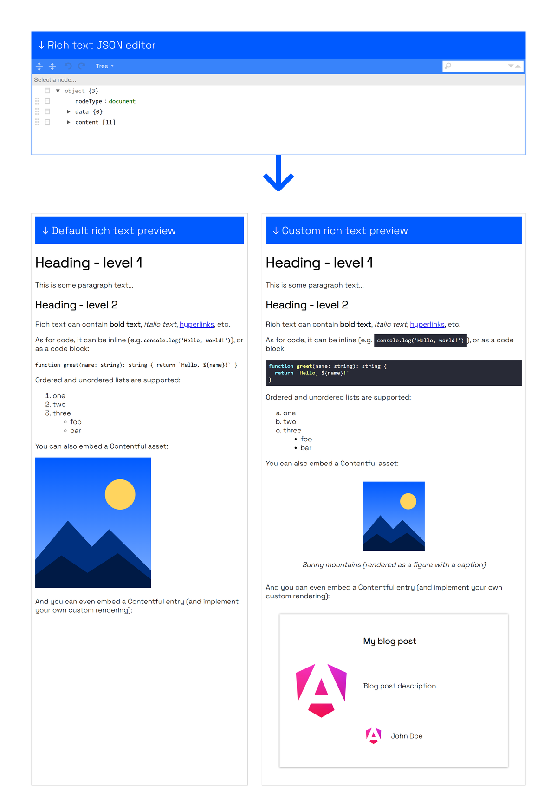

# contentful-rich-text-angular-renderer

Monorepo for [`@flowup/contentful-rich-text-angular-renderer`](./libs/contentful-rich-text-angular-renderer/README.md), an Angular library for template-driven rendering of Contentful rich text, and its [demo app](https://cf-rich-text-ng-demo.web.app/).

**→ For usage and customization, see the [library README](./libs/contentful-rich-text-angular-renderer/README.md).**



## Structure

| Path                                         | What                                                      |
| -------------------------------------------- | --------------------------------------------------------- |
| `libs/contentful-rich-text-angular-renderer` | The published library (built with ng-packagr)             |
| `apps/demo`                                  | Demo app: JSON editor with a default and a custom preview |
| `docs/images`                                | Screenshots used in the READMEs                           |

## Development

```sh
npm install
npx nx serve demo                                    # http://localhost:4200
npx nx test contentful-rich-text-angular-renderer    # Vitest unit tests
npx nx run-many -t build lint test                   # everything CI-relevant
```

## Publish flow

1. Update dependencies.
2. Run `npx nx run-many -t build lint test` and check that the demo app works correctly.
3. Open `libs/contentful-rich-text-angular-renderer/package.json`:
   - Bump the library `version`.
   - Check that all peer dependencies are correct.
   - Update the compatibility table in the library README if the Angular major changed.
4. Build the library with `npx nx run contentful-rich-text-angular-renderer:build:production`.
5. Change the working directory to the generated dist: `cd dist/libs/contentful-rich-text-angular-renderer`.
6. Check that all changes were reflected correctly:
   - Versions of (peer) dependencies.
   - Correct `version` of the library.
7. Publish with `npm publish`.
8. Publish the demo app with `firebase deploy --only hosting`.
